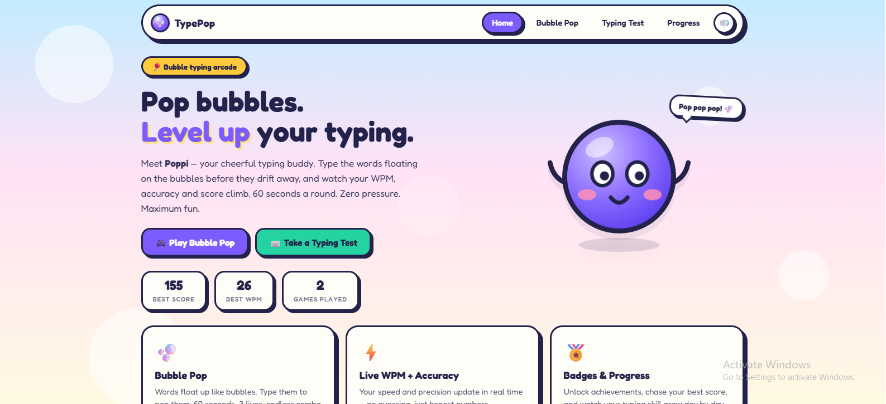
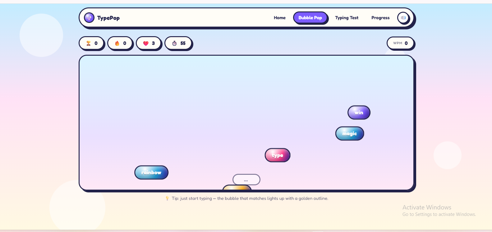
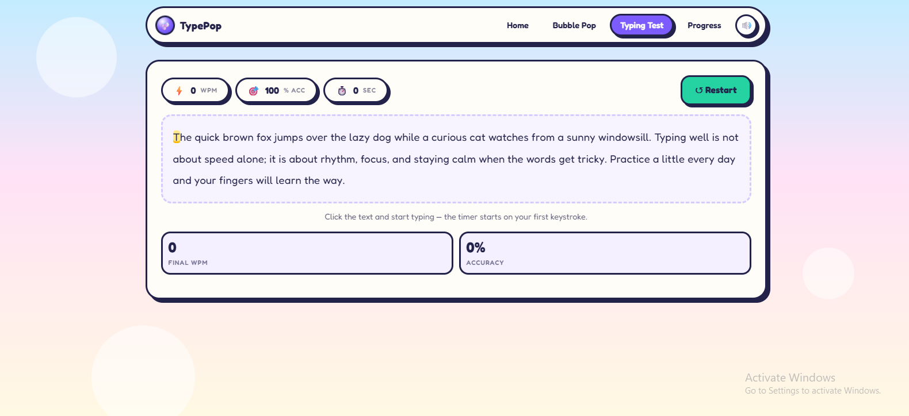
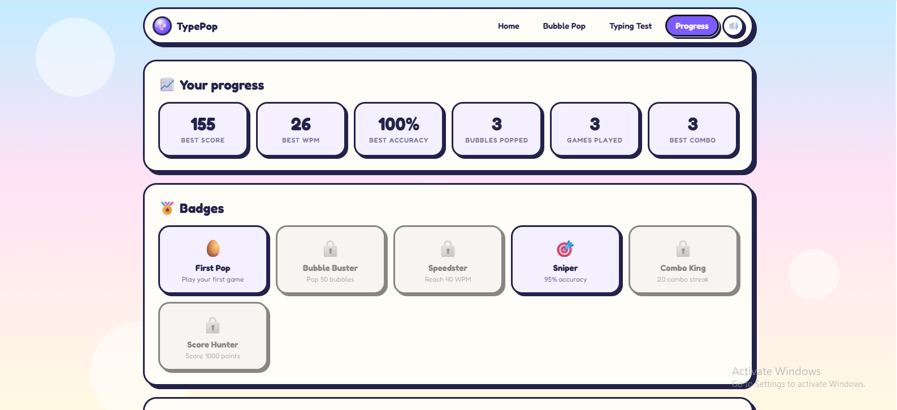

# 🫧 TypePop — Pop Bubbles, Level Up Your Typing

> A cartoon-style typing game + typing speed calculator built with **pure HTML, CSS and JavaScript**.
> Pop floating word bubbles before they drift away, track your WPM & accuracy in real time,
> and unlock badges as your typing skill grows.


---

## ✨ Features

- 🎮 **Bubble Pop Game** — Type the words on rising bubbles to pop them. 60-second rounds, 3 lives, escalating difficulty.
- ⚡ **Live Stats** — Real-time WPM, accuracy, combo streak and score tracking.
- ⌨️ **Typing Test** — A classic paragraph typing test with final WPM & accuracy results.
- 🏅 **Badges & Progress** — 6 unlockable achievements, personal bests, and a goal progress bar.
- 💾 **Local Save** — All stats, best scores and badges persist via `localStorage`.
- 🎨 **Creative Cartoon UI** — Mascot "Poppi", hand-drawn style shadows, floating decorations, confetti celebrations.
- 🔊 **Sound Effects** — Lightweight Web Audio API beeps for pops, misses and wins (toggleable).
- 📱 **Responsive** — Works on desktop, tablet and mobile.
- 🚫 **Zero Dependencies** — No frameworks, no build step, no libraries. Just open and play.

---

## 🖼️ Screenshots

| Home | Bubble Pop Game |
|------|-----------------|
|  |  |

| Typing Test | Progress & Badges |
|-------------|-------------------|
|  |  |

---

## 🚀 Live Demo

👉 **[Play TypePop](https://ashutoshguptagh.github.io/typepop/)**
*(Replace with your GitHub Pages URL)*

---

## 🛠️ Tech Stack

| Layer | Technology |
|-------|------------|
| Structure | HTML5 |
| Styling | CSS3 (custom properties, animations, gradients) |
| Logic | Vanilla JavaScript (ES6+) |
| Storage | `localStorage` |
| Audio | Web Audio API |
| Fonts | Google Fonts — Fredoka |

---

## 📁 Project Structure

```
typepop/
│
├── index.html          # Main HTML (all pages/sections)
├── css/
│   └── style.css       # All styling, animations, responsive rules
├── js/
│   └── script.js       # Game logic, typing test, stats, routing
├── screenshots/        # Preview images for README
└── README.md
```

---

## 🕹️ How to Play

1. Open `index.html` in any modern browser (or visit the live demo).
2. Click **"Play Bubble Pop"** and press **Start Popping**.
3. Type the word shown on any bubble — matching bubbles get a golden outline.
4. Pop as many as you can in **60 seconds** without missing **3 bubbles**.
5. Track your **WPM**, **accuracy** and **combo** — then check the **Progress** page to unlock badges!

---

## 🎯 Scoring & Badges

- **Score** = `word length × 10` + `combo × 5` per popped bubble.
- **Combo** increases with every successful pop and resets on a miss.
- **Badges unlock** for milestones like *First Pop*, *Speedster (40 WPM)*, *Sniper (95% accuracy)*, *Combo King (20 streak)* and *Score Hunter (1000 pts)*.

---

## 🧩 Customization

Want to make it your own? Easy tweaks:

| What to change | Where |
|----------------|-------|
| Round length | `timeLeft = 60` in `script.js` |
| Starting lives | `lives = 3` in `script.js` |
| Word list | `WORDS` array in `script.js` |
| Typing test paragraph | `TEST_TEXT` in `script.js` |
| Theme colors | `:root` variables in `style.css` |
| Mascot phrases | `PHRASES` array in `script.js` |

---

## 🧪 Browser Support

✅ Chrome · ✅ Firefox · ✅ Edge · ✅ Safari · ✅ Brave
*(Requires a browser with ES6 + `localStorage` + Web Audio API support — all modern browsers qualify.)*

---

## 🤝 Contributing

Contributions, ideas and bug reports are welcome!

1. Fork the repository
2. Create your branch: `git checkout -b feature/my-idea`
3. Commit your changes: `git commit -m "Add my idea"`
4. Push: `git push origin feature/my-idea`
5. Open a Pull Request

---

## 📄 License

This project is licensed under the **MIT License** — free to use, modify and share.

---

## 🙌 Acknowledgements

- Font: [Fredoka](https://fonts.google.com/specimen/Fredoka) by Google Fonts
- Inspired by classic typing tutors, reimagined as a playful bubble-popping arcade
- Mascot **Poppi** — hand-crafted in pure SVG 🎨

---

<p align="center">
  <b>Made with 💜 and a lot of bubble wrap.</b><br>
  ⭐ Star this repo if TypePop helped you type faster!
</p>
